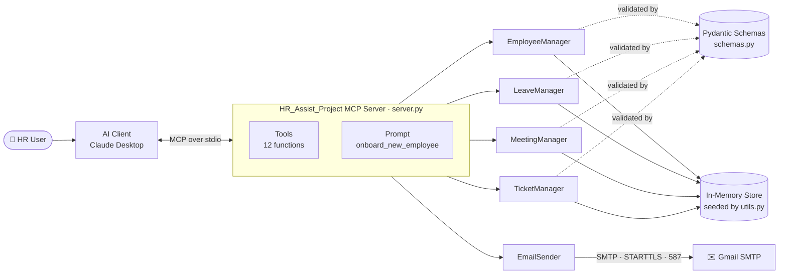
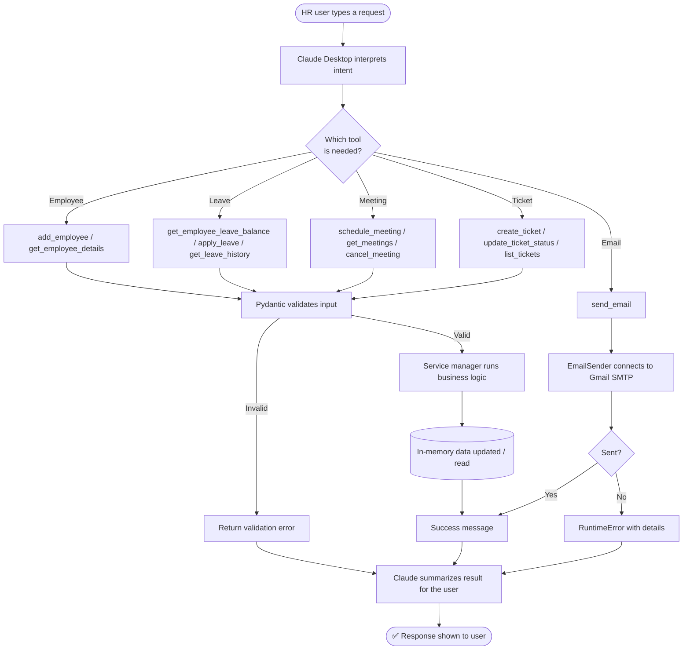
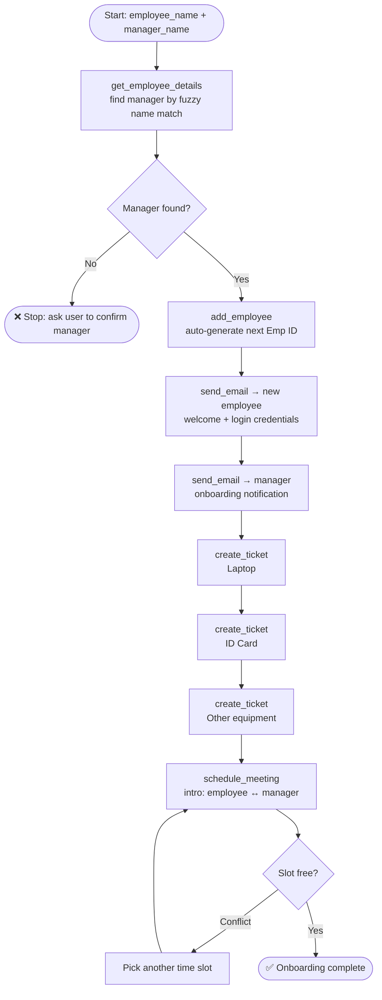
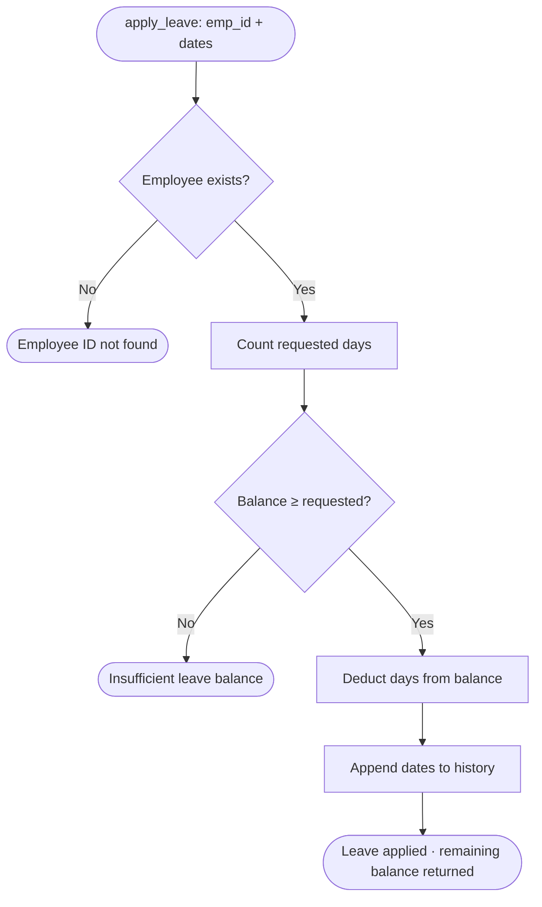
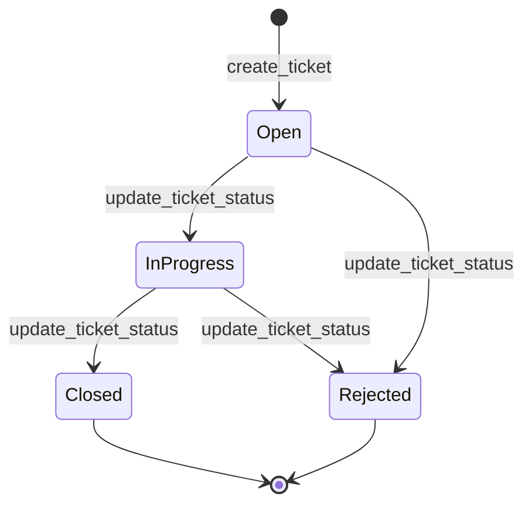
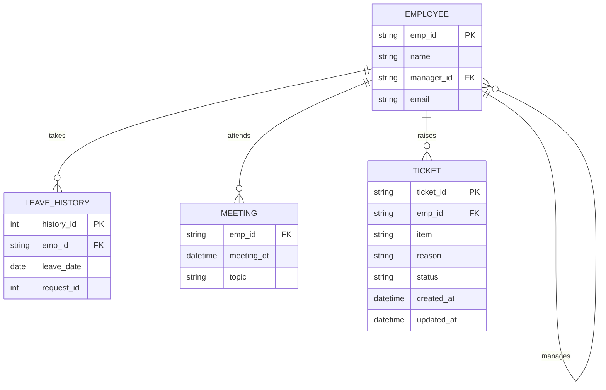

# 🧑‍💼 HR Assist — MCP Server for HR Operations


**HR Assist** is a [Model Context Protocol (MCP)](https://modelcontextprotocol.io) server that lets an AI assistant (such as Claude Desktop) carry out everyday HR tasks through natural language: managing employees, applying for leave, scheduling meetings, raising IT/equipment tickets, and sending emails — all from a single conversation.

Instead of clicking through multiple HR tools, an HR executive can simply say:

> *"Onboard Priya Verma under Tony Sharma, email her, raise tickets for a laptop and ID card, and schedule an intro meeting with her manager."*

…and the assistant orchestrates the right tools in the right order.

---

## 📑 Table of Contents

- [Key Features](#-key-features)
- [System Architecture](#-system-architecture)
- [Workflow Flowcharts](#-workflow-flowcharts)
- [Tech Stack](#-tech-stack)
- [Project Structure](#-project-structure)
- [Available Tools](#-available-tools)
- [Prompt Templates](#-prompt-templates)
- [Getting Started](#-getting-started)
- [Connecting to Claude Desktop](#-connecting-to-claude-desktop)
- [Example Conversations](#-example-conversations)
- [Testing](#-testing)
- [Data Model](#-data-model)
- [Known Limitations](#-known-limitations)
- [Roadmap](#-roadmap)
- [Author](#-author)

---

## ✨ Key Features

| Module | Capabilities |
|---|---|
| 👥 **Employee Management** | Add employees with auto-generated IDs, fuzzy name search, manager hierarchy validation |
| 🌴 **Leave Management** | Check balance, apply for leave (with balance validation), view leave history |
| 📅 **Meeting Scheduler** | Schedule, list, and cancel meetings with automatic conflict detection |
| 🎫 **Ticketing** | Raise equipment/software requests, update status, filter by employee and status |
| ✉️ **Email Automation** | Send plain or HTML emails over Gmail SMTP (STARTTLS) with attachment support |
| 🚀 **Onboarding Prompt** | A reusable MCP prompt that chains all of the above into one onboarding workflow |
| ✅ **Typed Validation** | All inputs validated through Pydantic schemas before touching business logic |

---

## 🏗 System Architecture

The server follows a clean layered design: the **MCP layer** exposes tools to the AI client, the **service layer** (`HRMS/`) holds the business logic, and the **integration layer** handles outbound email.



---

## 🔄 Workflow Flowcharts

### 1. End-to-End Request Flow

How a single natural-language request travels through the system:



### 2. Employee Onboarding Workflow

Triggered by the `onboard_new_employee` prompt — the AI executes each step using the tools above.



### 3. Leave Application Logic



### 4. Ticket Lifecycle



---

## 🛠 Tech Stack

| Layer | Technology |
|---|---|
| Language | Python 3.11+ |
| Protocol / Framework | [MCP Python SDK](https://github.com/modelcontextprotocol/python-sdk) (`mcp[cli]`) |
| Data Validation | Pydantic v2 |
| Email | `smtplib` + `email.message` (Gmail SMTP, STARTTLS) |
| Config | `python-dotenv` |
| Search | `difflib.get_close_matches` (fuzzy name matching) |
| Package Management | [uv](https://docs.astral.sh/uv/) |
| Transport | stdio |

---

## 📁 Project Structure

```
HR_Assist_Project/
├── server.py                 # MCP server: tool + prompt registration, entry point
├── email_manager.py          # EmailSender class (SMTP, HTML, attachments)
├── utils.py                  # seed_services(): populates dummy HR data
├── HRMS/                     # Business-logic service layer
│   ├── __init__.py
│   ├── employee_manager.py   # Employees, hierarchy, fuzzy search
│   ├── leave_manager.py      # Leave balance, apply, history
│   ├── meeting_manager.py    # Schedule / list / cancel with conflict checks
│   ├── ticket_manager.py     # Equipment & software request tickets
│   └── schemas.py            # Pydantic request/response models
├── test/
│   ├── test_employee.py      # Fuzzy search & seeding sanity check
│   └── smtp_check.py         # Gmail SMTP connectivity check
├── src/hr_assist_project/    # Package scaffold (uv)
├── pyproject.toml            # Project metadata & dependencies
├── uv.lock                   # Locked dependency versions
├── .python-version           # Python 3.11
└── .env                      # Local secrets (never commit!)
```

---

## 🧰 Available Tools

### 👥 Employee
| Tool | Description | Parameters |
|---|---|---|
| `add_employee` | Adds a new employee; ID is auto-generated (`E009`, `E010`, …) | `name`, `manager_id`, `email` |
| `get_employee_details` | Finds an employee by (fuzzy) name and returns their record | `name` |

### 🌴 Leave
| Tool | Description | Parameters |
|---|---|---|
| `get_employee_leave_balance` | Returns remaining leave days | `emp_id` |
| `apply_leave` | Applies leave for the given dates; rejects if balance is insufficient | `emp_id`, `leave_dates` |
| `get_leave_history` | Lists past leave dates | `emp_id` |

### 📅 Meetings
| Tool | Description | Parameters |
|---|---|---|
| `schedule_meeting` | Books a meeting; raises an error on time conflicts | `employee_id`, `meeting_datetime`, `topic` |
| `get_meetings` | Returns meetings sorted by date | `employee_id` |
| `cancel_meeting` | Cancels a meeting by date/time (and topic) | `employee_id`, `meeting_datetime`, `topic` |

### 🎫 Tickets
| Tool | Description | Parameters |
|---|---|---|
| `create_ticket` | Raises a request (Laptop, ID Card, …) with status `Open` | `emp_id`, `item`, `reason` |
| `update_ticket_status` | Sets status to `Open`, `In Progress`, `Closed`, or `Rejected` | `ticket_id`, `status` |
| `list_tickets` | Lists tickets for an employee, filtered by status | `employee_id`, `status` |

### ✉️ Email
| Tool | Description | Parameters |
|---|---|---|
| `send_email` | Sends an email from the configured HR account | `subject`, `body`, `to_emails` |

---

## 💬 Prompt Templates

| Prompt | Purpose | Arguments |
|---|---|---|
| `onboard_new_employee` | Guides the AI through the complete onboarding checklist: add employee → welcome email → notify manager → raise equipment tickets → schedule intro meeting | `employee_name`, `manager_name` |

---

## 🚀 Getting Started

### Prerequisites

- Python **3.11+**
- [`uv`](https://docs.astral.sh/uv/getting-started/installation/) package manager
- A Gmail account with a **Google App Password** (requires 2-Step Verification)
- Claude Desktop (or any MCP-compatible client)

### 1. Clone the repository

```bash
git clone https://github.com/Aashi1102/HR_Assist_Project.git
cd HR_Assist_Project
```

### 2. Install dependencies

```bash
uv sync
```

### 3. Configure environment variables

Create a `.env` file in the project root:

```env
Email=your_hr_email@gmail.com
Password=your_16_character_google_app_password
```

> ⚠️ **Never commit `.env`.** Make sure it is listed in `.gitignore`, and use a Google *App Password* — not your real account password.

### 4. Verify SMTP (optional)

```bash
uv run python test/smtp_check.py
```

### 5. Run the server

**Interactive debugging with MCP Inspector:**

```bash
uv run mcp dev server.py
```

**Plain stdio mode:**

```bash
uv run python server.py
```

---

## 🔌 Connecting to Claude Desktop

Add the server to your `claude_desktop_config.json`:

```json
{
  "mcpServers": {
    "HR_Assist_Project": {
      "command": "uv",
      "args": [
        "--directory",
        "/absolute/path/to/HR_Assist_Project",
        "run",
        "server.py"
      ]
    }
  }
}
```

Restart Claude Desktop — the HR tools and the `onboard_new_employee` prompt will appear in the tools menu.

---

## 🗣 Example Conversations

| You say | Tools the assistant uses |
|---|---|
| *"How many leave days does Tony Sharma have left?"* | `get_employee_details` → `get_employee_leave_balance` |
| *"Apply leave for E004 on 2026-12-24 and 2026-12-26."* | `apply_leave` |
| *"Set up a 1:1 between Emily Kim and her manager tomorrow at 11 AM."* | `get_employee_details` → `schedule_meeting` |
| *"Show all open tickets for E008."* | `list_tickets` |
| *"Email the team that Friday's sync is cancelled."* | `send_email` |
| *"Onboard Priya Verma under Tony Sharma."* | `onboard_new_employee` prompt → full workflow |

---

## 🧪 Testing

```bash
# Seeding + fuzzy search sanity check
uv run python test/test_employee.py

# Gmail SMTP authentication check
uv run python test/smtp_check.py
```

---

## 🗄 Data Model

The server ships with **seeded demo data** (8 employees, random leave history, meetings, and tickets) generated by `utils.seed_services()` on every start.



---

## ⚠️ Known Limitations

- **In-memory storage** — all data resets when the server restarts.
- **Demo data** — the seeded employees, leave, meetings and tickets are randomly generated.
- **No authentication / roles** — any connected client can call any tool.
- **Single email provider** — currently configured for Gmail SMTP only.

---

## 🗺 Roadmap

- [ ] Persistent storage (SQLite / PostgreSQL)
- [ ] Role-based access control (employee vs. manager vs. HR admin)
- [ ] Leave approval workflow with manager notifications
- [ ] Calendar integration (Google Calendar / Outlook)
- [ ] Automated unit tests with `pytest` and CI via GitHub Actions
- [ ] Docker support and remote (HTTP/SSE) transport

---

## 👩‍💻 Author

**Aashi Tomar**
B.Tech CSE (AI & ML), OIST Bhopal
🔗 [GitHub](https://github.com/Aashi1102) · [LinkedIn](https://www.linkedin.com)

---

<p align="center">⭐ If you found this project useful, consider giving it a star!</p>
